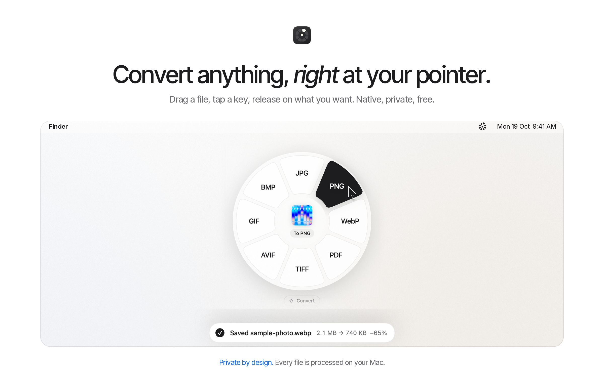
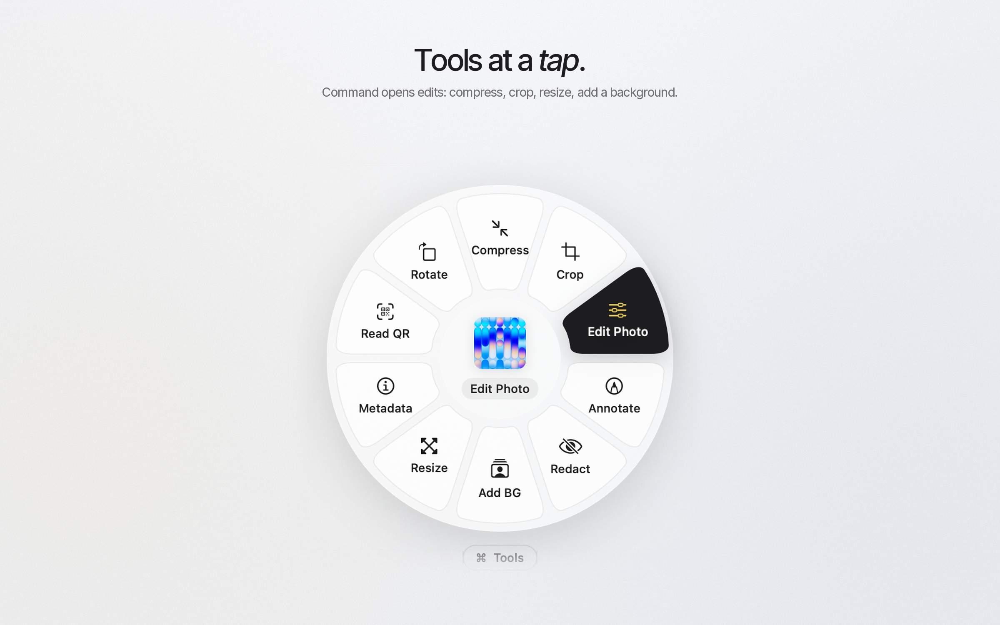
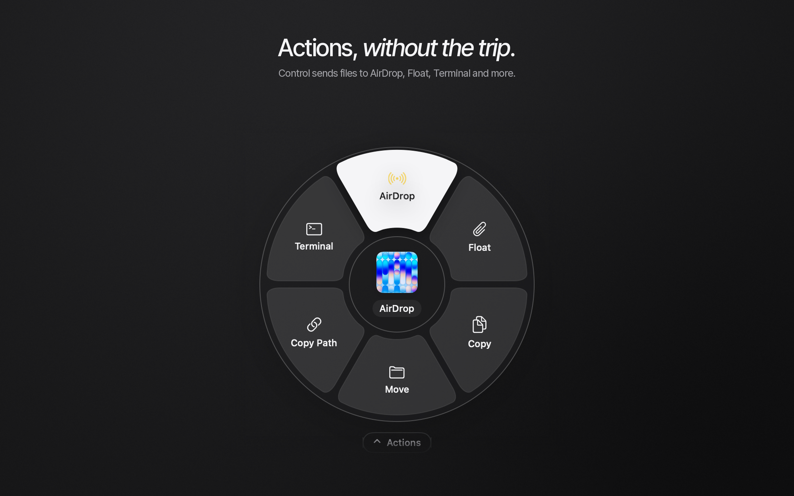
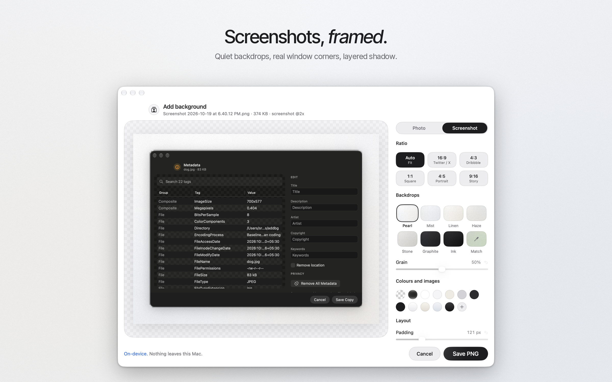
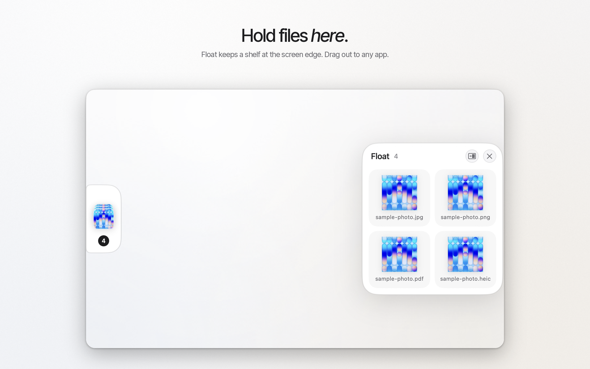
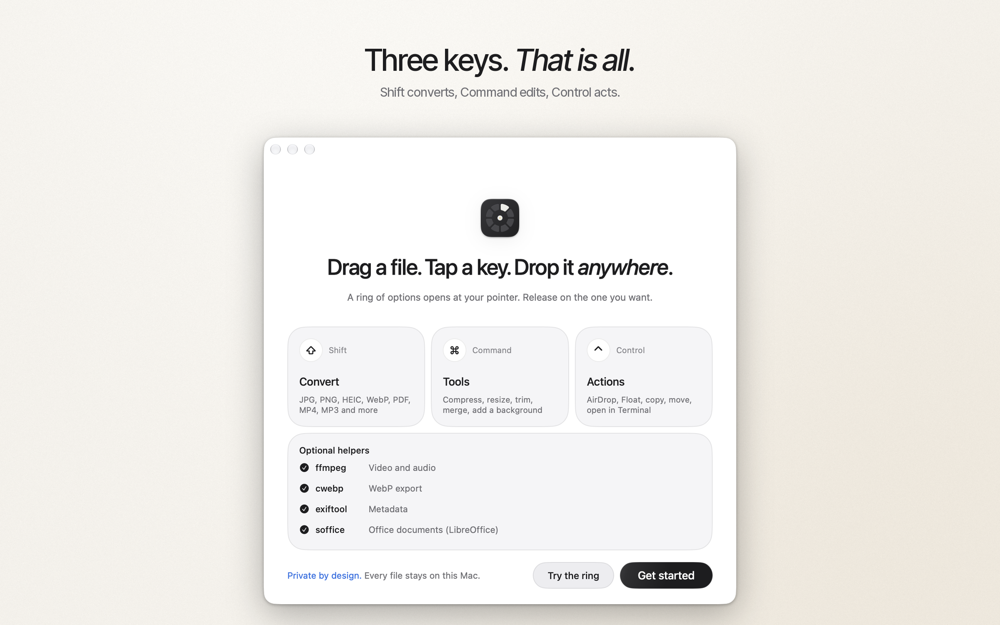

<p align="center">
  
</p>

<h1 align="center">Yuzu</h1>

<p align="center">
  Convert, edit and act on files, <i>right</i> at your pointer.<br>
  Drag a file, tap a key, release on what you want.
</p>

<p align="center">
  <a href="https://github.com/sreecharan-desu/yuzu/releases/latest"></a>
  <a href="https://github.com/sreecharan-desu/yuzu/actions/workflows/ci.yml"></a>
  
  <a href="LICENSE"></a>
</p>

<p align="center">
  
</p>

Yuzu is a small, native menu bar app for macOS. While you drag any file, tap a modifier key and a
ring opens under the pointer with what you can do with that file. Drop on an option and the
result is saved next to the original. Nothing is uploaded anywhere.

## Features

- **Three rings, three keys.** Shift converts, Command opens tools, Control runs actions. Every key is
  configurable in Settings with a shortcut recorder.
- **Convert almost anything** (about 270 source and target pairs):
  - Images: JPG, PNG, HEIC, WebP, AVIF, TIFF, GIF, BMP, PDF, SVG input
  - Video: MP4, MOV, MKV, WebM, AVI, WMV, animated GIF, plus audio extraction
  - Audio: MP3, M4A, WAV, FLAC, AIFF, OGG, Opus, WMA
  - Documents, slides and sheets: DOCX, DOC, RTF, ODT, EPUB, HTML, Markdown, TXT, PDF, PPTX, ODP, XLSX, ODS, CSV, TSV
  - Subtitles (SRT and VTT) and archives (ZIP, TAR, TGZ, extract)
- **26 tools.** Compress, resize, half size, rotate, flip, crop, edit photo, annotate, redact, add
  background (including a screenshot mode with eight quiet backdrops and social ratios), metadata
  viewer and editor, read QR codes, make PDF, merge, split and organize PDF pages, trim, speed,
  split, mute, join, bleep, normalize, channels, crop video, and compress video, audio and PDF.
- **Actions.** AirDrop, Float, Copy, Copy Path, Move, Open in Terminal.
- **Float.** A shelf for files. Drop files on it, drag them out to any app, and park it on a screen
  edge as a small glass tab that opens on hover.
- **Fast.** The ring is on screen within the first display refresh after the key tap (median 8.8 ms
  on an M1 MacBook Air), multi-file jobs run in parallel, and image conversions use ImageIO directly.
- **Light.** About 0.1% CPU and 75 MB of memory when idle.

<p align="center">
  
  
</p>
<p align="center">
  
  
</p>

## Install

1. Download **Yuzu.dmg** from the [latest release](https://github.com/sreecharan-desu/yuzu/releases/latest).
2. Open it and drag **Yuzu** into **Applications**.
3. Open Yuzu from Applications. It's ad-hoc signed, not notarized, so the first time macOS will say it
   can't verify the developer:
   - Open **System Settings > Privacy & Security**, scroll to the message about Yuzu, click **Open Anyway**, and confirm.
   - Or right-click Yuzu in Applications, choose **Open**, then **Open**.
4. Yuzu appears in the menu bar and shows a short welcome.

You can check the download against the `Yuzu.dmg.sha256` file on the release page:

```sh
shasum -a 256 ~/Downloads/Yuzu.dmg
```


### Optional helpers

Images, PDFs and most tools work with nothing extra. Video, audio, WebP and Office formats use
well-known command line tools from [Homebrew](https://brew.sh):

```sh
brew install ffmpeg webp exiftool
brew install --cask libreoffice   # optional, for Word, PowerPoint and Excel files
```

The welcome window and **Settings > About** show which helpers Yuzu found.

## Using Yuzu

| While dragging a file, tap | Ring | What you get |
| --- | --- | --- |
| Shift (⇧) | Convert | Formats the file can become |
| Command (⌘) | Tools | Edits and tools for that kind of file |
| Control (⌃) | Actions | AirDrop, Float, copy, move, Terminal |

- Keep holding the mouse button, move onto an option, release to run it. Release anywhere else to cancel.
- Tap a different key while the ring is open to switch rings.
- Results are saved next to the original with a new name. Originals are never changed.
- Change the keys in **Settings > Shortcuts**: click a shortcut, press the modifier keys you want, release.

<p align="center"></p>

### Permissions

Yuzu watches for a modifier key tap during a file drag. It doesn't read your keystrokes and
needs no special permission for that. AirDrop and Login Items use the standard macOS prompts.

## Privacy

Everything runs on your Mac. Yuzu has no accounts, no analytics, no telemetry and no network code.
Files are processed locally with Apple frameworks (ImageIO, AVFoundation, PDFKit, Vision) and the
optional helpers you install yourself.

## Build from source

Requirements: macOS 26 or later, Xcode 26 or later, and [XcodeGen](https://github.com/yonaskolb/XcodeGen).

```sh
brew install xcodegen
git clone https://github.com/sreecharan-desu/yuzu.git
cd yuzu
scripts/build.sh          # Release build, ad-hoc signed, into dist/Yuzu.app
open dist/Yuzu.app
```

To make the disk image as well:

```sh
brew install create-dmg
scripts/make-dmg.sh       # dist/Yuzu.dmg and dist/Yuzu.dmg.sha256
```

Test fixtures are generated, not stored: `scripts/make-fixtures.sh` builds one small file per
supported format (needs ffmpeg and LibreOffice), and `scripts/validate.swift` checks a batch report.

## Project layout

```
Yuzu/App        app delegate, menu bar, welcome window, login item
Yuzu/Drag       drag and modifier tap detection
Yuzu/Wheel      the ring: model, view, geometry, thumbnail cache
Yuzu/Catalog    what each file kind can become or do
Yuzu/Jobs       conversion engines and the parallel job runner
Yuzu/Tools      tool panels and editors
Yuzu/Float      the Float shelf
Yuzu/HUD        progress and result toasts
Yuzu/Settings   preferences and the shortcut recorder
scripts/        build, disk image, icon and fixture scripts
```

## Contributing

Bug reports, ideas and pull requests are welcome. See [CONTRIBUTING.md](CONTRIBUTING.md) and the
[changelog](CHANGELOG.md). Please report security issues privately as described in [SECURITY.md](SECURITY.md).

## License

[MIT](LICENSE)
